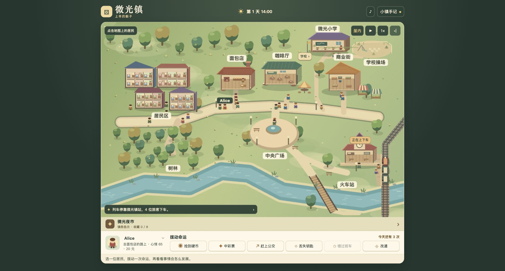
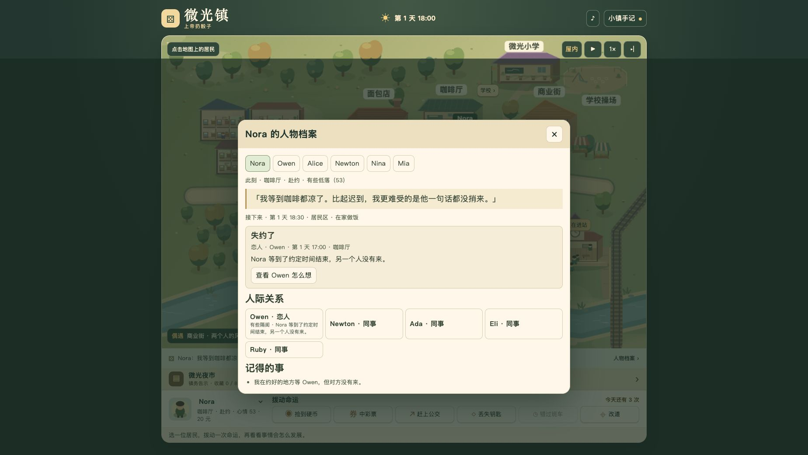
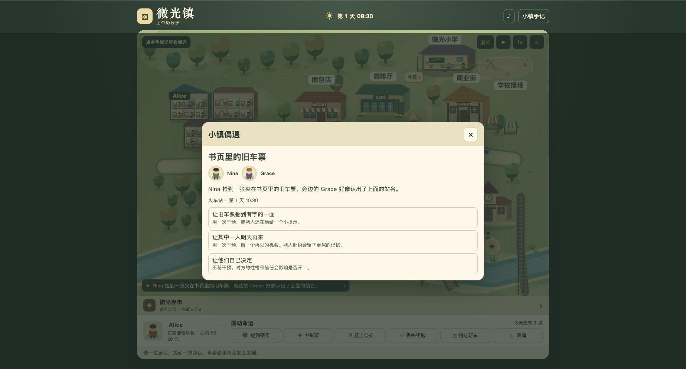
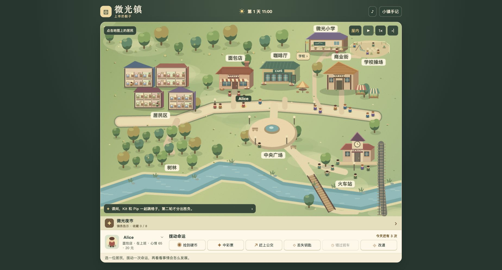
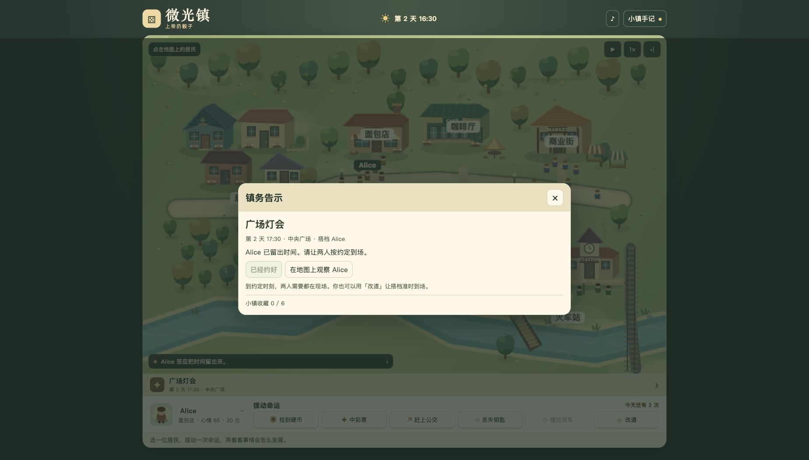
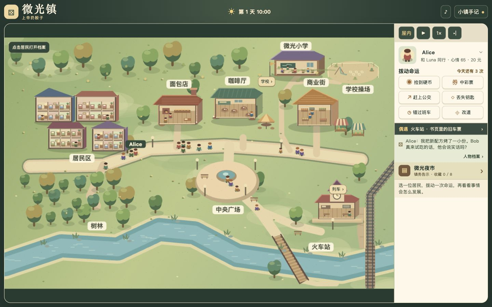
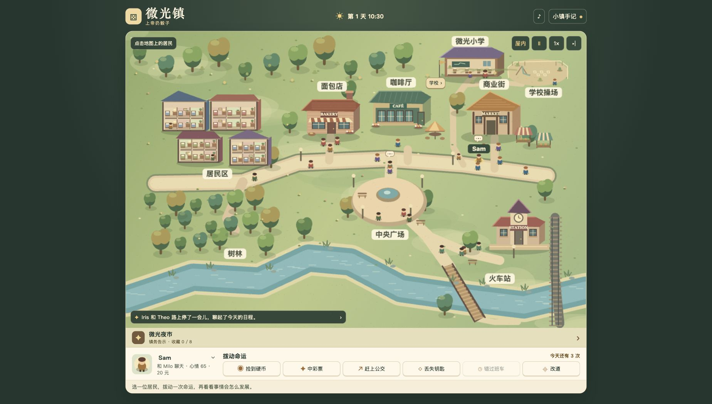

# 上帝扔骰子 · 微光镇

**[在线试玩《上帝扔骰子》](https://aubreykuang.github.io/SmallTown/)**



29 名居民按职业、习惯和时间在居民区、商街、咖啡厅、面包店、树林、广场、车站和学校活动。玩家每天有三次机会改变条件，观察影响如何顺着真实相遇和人物关系传播。

## 人物档案与掷骰

直接点地图上的居民就会打开人物档案。也可以用居民下拉菜单选人，再点地图下方的「人物档案」。可以查看他正在做什么、心情如何、按当前日程接下来要去哪、跟谁是恋人、家人、朋友、同事或同学，以及最近记得什么。点关系里的人名可以直接切换到对方的档案。

Nora 和 Owen、June 和 Milo 会按自己的日程约会。比如 Nora 在咖啡厅等，Owen 可能还在收摊。可以观察两人各自怎么想，或者花一次干预掷骰，看收摊能不能早点结束。赴约取决于两人是否到场和彼此的信任。失约会影响各自的心情与记忆，之后还有机会见面把话说开。



Alice、Newton、Nina 和 Mia 各有两段会随经历推进的心愿。为心愿掷骰会花一次干预。1–2 点会犹豫，3–4 点会自己去等，5–6 点会给双方留出碰面的机会。日程和信任会影响两人是否赴约。骰点、心愿进度和约会结果都会保存。

## 地图偶遇

地图底部的「偶遇」消息可以打开正在发生的故事，预约后入口会显示「赴约」。开局可以在车站看到旧车票，随后也可能碰到面包分赠、操场上的纸飞机、咖啡厅的空座或商街的风铃等情况。参与者来自当时实际到场的居民。

你可以花一次干预给当场提示，安排次日再见，或者把决定交给居民。自然处理取决于他们已有的信任和性格，改天见面则要两人实际赴约。成功相遇会增加双方信任，留下各自的记忆。如果之后再次在外碰面，还可能出现回访。地图下方追踪本次选择及后续，居民手记显示记忆和信任变化。



## 微光小学

点地图右上方的「学校」查看老师 Marin 和四名学生。平日有上课和课间，晴天孩子会去操场，下雨或下雪则留在教室。周末不上课。放学后，孩子可能留在操场玩、去街上或回家写作业，回到家碰上家人时也会聊起当天的事。课间和家庭互动会留下双方各自的记忆。

学校告示有两条可选活动，操场观察角和教室故事会。选搭档后，次日 15:30 集合。办成后地图会留下花坛或书架，并给以后的课间增加相应活动。旧存档会在原有日期和进度上加入学校居民。



## 镇务告示

在地图下方打开告示。微光夜市、没写地址的包裹、河岸的纪念按游戏日轮换，每个故事有两种办成的方式。比如筹备夜市时，可以找面包店员工在商街开一张长桌，也可以找热心邻居在广场挂灯。

选定方案和搭档后，镇务在次日 17:30 结算。搭档愿不愿意帮忙取决于职业、性格和对发起人的信任。你可以挑一位按日程就会到场的搭档，花一次干预约好时间，或临近集合时用「改道」。告示可以快进到集合前一小时，途中仍按原规则结算小镇事件。两位居民都到场且搭档愿意帮忙时，项目才会完成。成功后会留下双方的记忆、增加彼此信任，并在地图上留下纪念物。镇务和学校共有八件可收藏的纪念物，已经筹备中的活动也会保存。



## 日常玩法

- 点击地图上的居民，再选择错过班车、丢钥匙、捡硬币、赶上公交、中彩票或改道。选择改道后可以直接点击地图上的目的地。
- 改道只有遇到按日程到访该地点的居民才会触发会面。中彩票可能引起借钱与冲突，找钥匙可能促成帮助。底部显示本次干预的后续，小镇手记保留事件的起因和居民记忆。关系和分层记忆影响居民之后是否愿意借钱。
- 每位居民有自己的起床时间、班次、午休、休息日和睡觉时间。空闲时，有的人在家做饭或看书，有的人外出散步、逛店或喝咖啡。雨雪天更容易选室内活动。处于同一地点且有空的居民有机会自然聊起来，双方各自留下记忆。
- 多次异常会让居民开始怀疑巧合，善于观察的 Newton 更早察觉。小镇有晴天、下雨、下雪。停电时，一些居民会分批去广场看星星。
- Canvas 2D 绘制地图和居民，Web Audio 合成操作音效。游戏不依赖服务器、外部资源或 LLM。
- LocalStorage 版本化存档包含时间、随机状态、居民、未结算事件和因果记录。主档损坏时尝试读取上一有效快照。支持 JSON 导出和导入，离线推进默认关闭，可开启并最多补算一个游戏日。
- 目前事件链用于查询和继续结算，尚未提供从任意事件重放世界的工具。

## 小镇界面

宽屏上，地图按原比例铺满左侧可用空间，时钟、掷骰和居民操作集中在右侧独立滚动栏。手机和窄窗口会切成单列，地图占满屏宽，操作在地图下方。



[查看手机单列布局截图](docs/map-mobile.jpg)

住宅分别有阁楼、围院、砖墙和白墙。面包店带砖炉和雨棚，咖啡厅有玻璃门面和露台，商业街有木构店面和露天摊位，火车站有站台和钟楼。广场、河岸木桥与林间小径也补上了各自的地标。

操作栏里的「屋内／外观」可切换住宅、面包店、咖啡厅、商街、学校和车站的剖面。居民会沿门口进出，在室内上班、喝咖啡、上课或候车时会显示在对应房间里。点屋内或屋外的居民可以查看当前活动、目的地、心情和余额。

火车每天 **09:00、14:00、18:30** 到站。列车沿轨道进站、开门停靠、再离开。旅客依次上下车，下车的旅客会走到店铺附近，之后回来搭下一班。点车站旁的按钮可以看时刻和各班上下车人数，抵达和发车会记入小镇手记。

新开局从第一天早上 08:30 开始，已有进度从存档时间继续。默认每 7.2 秒推进半小时，可暂停、切换 3× 或单步。居民有各自的步速，起步和抵达时会放缓。赶路途中如果改变目的地，居民从当前位置沿道路转向。3× 加快游戏时钟，走路只稍微加快。打开小镇手记会暂停时间和步行。

方向相近的居民有机会放慢到相同的步速，一起走一段。路上碰见别人时也可能停下聊天，地图会显示对话气泡。点其中一位居民可以看到同行或聊天对象，聊完的内容会进入双方的记忆。同一天的同一对居民最多记一条路上聊天，避免手记被重复内容占满。



河面水纹会随时间流动，雨雪随风移动。晴朗的夜里树林会出现萤火虫，街灯在通电时照亮路面。

## 运行与验证

用浏览器打开 `index.html`，或运行 `python3 -m http.server 8000` 后访问 `http://localhost:8000`。使用 Node.js 22 执行：

```sh
node --test tests/*.test.cjs
```

脚本覆盖公共建筑的室内落脚点、进出路线、列车与旅客流量、骰点分支、关系影响和存档恢复。Chrome 实测了建筑切换、列车移动、发车记录、心声切换、实际掷骰扣次和刷新后保留结果。
