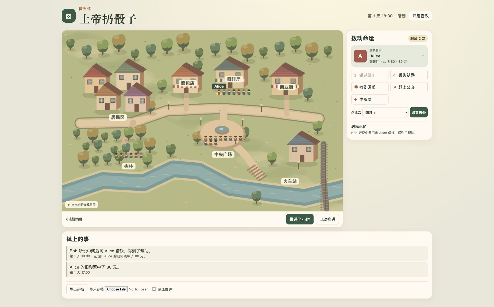

# 上帝扔骰子 · 微光镇

**[在线试玩《上帝扔骰子》](https://aubreykuang.github.io/SmallTown/)**



29 名居民按职业、习惯和时间在居民区、商街、咖啡厅、面包店、树林、广场、车站和学校活动。玩家每天有三次机会改变条件，观察影响如何顺着真实相遇和人物关系传播。

## 微光小学

点地图右上方的「学校」查看老师 Marin 和四名学生。平日有上课和课间，晴天孩子会去操场，下雨或下雪则留在教室。周末不上课。放学后，孩子可能留在操场玩、去街上或回家写作业，回到家碰上家人时也会聊起当天的事。课间和家庭互动会留下双方各自的记忆。

学校告示有两条可选活动，操场观察角和教室故事会。选搭档后，次日 15:30 集合。办成后地图会留下花坛或书架，并给以后的课间增加相应活动。旧存档会在原有日期和进度上加入学校居民。


## 镇务告示

在地图下方打开告示。微光夜市、没写地址的包裹、河岸的纪念按游戏日轮换，每个故事有两种办成的方式。比如筹备夜市时，可以找面包店员工在商街开一张长桌，也可以找热心邻居在广场挂灯。

选定方案和搭档后，镇务在次日 17:30 结算。搭档愿不愿意帮忙取决于职业、性格和对发起人的信任。你可以挑一位按日程就会到场的搭档，花一次干预约好时间，或临近集合时用「改道」。告示可以快进到集合前一小时，途中仍按原规则结算小镇事件。两位居民都到场且搭档愿意帮忙时，项目才会完成。成功后会留下双方的记忆、增加彼此信任，并在地图上留下纪念物。镇务和学校共有八件可收藏的纪念物，已经筹备中的活动也会保存。


## 日常玩法

- 点击地图上的居民，再选择错过班车、丢钥匙、捡硬币、赶上公交、中彩票或改道。选择改道后可以直接点击地图上的目的地。
- 改道只有遇到按日程到访该地点的居民才会触发会面。中彩票可能引起借钱与冲突，找钥匙可能促成帮助。底部显示本次干预的后续，小镇手记保留事件的起因和居民记忆。关系和分层记忆影响居民之后是否愿意借钱。
- 每位居民有自己的起床时间、班次、午休、休息日和睡觉时间。空闲时，有的人在家做饭或看书，有的人外出散步、逛店或喝咖啡。雨雪天更容易选室内活动。处于同一地点且有空的居民有机会自然聊起来，双方各自留下记忆。
- 多次异常会让居民开始怀疑巧合，善于观察的 Newton 更早察觉。小镇有晴天、下雨、下雪。停电时，一些居民会分批去广场看星星。
- Canvas 2D 绘制地图和居民，Web Audio 合成操作音效。游戏不依赖服务器、外部资源或 LLM。
- LocalStorage 版本化存档包含时间、随机状态、居民、未结算事件和因果记录。主档损坏时尝试读取上一有效快照。支持 JSON 导出和导入，离线推进默认关闭，可开启并最多补算一个游戏日。
- 目前事件链用于查询和继续结算，尚未提供从任意事件重放世界的工具。

## 小镇界面

住宅分别有阁楼、围院、砖墙和白墙。面包店带砖炉和雨棚，咖啡厅有玻璃门面和露台，商业街有木构店面和露天摊位，火车站有站台和钟楼。广场、河岸木桥与林间小径也补上了各自的地标。

右上角「屋内／外观」可切换住宅剖面。居民有固定的家庭住处，回家会走向自己的住宅，睡着的人会停在床边。点屋内或屋外的居民可以查看当前活动、目的地、心情和余额。

新开局从第一天早上 08:30 开始，已有进度从存档时间继续。默认每 3.6 秒推进半小时，可暂停、切换 3× 或单步。步行独立于时钟更新，每位居民以自己的速度和停留时间活动，换地点时沿街道走。打开小镇手记会暂停时间和步行。

## 运行与验证

用浏览器打开 `index.html`，或运行 `python3 -m http.server 8000` 后访问 `http://localhost:8000`。使用 Node.js 22 执行：

```sh
node --test tests/*.test.cjs
```

脚本覆盖独立日程、旧存档升级、晴雨课间、不同放学活动、周末休息，以及八个活动方案。Chrome 实测了课间名单、故事会筹备后刷新、结算和 390 像素宽的学校入口。
