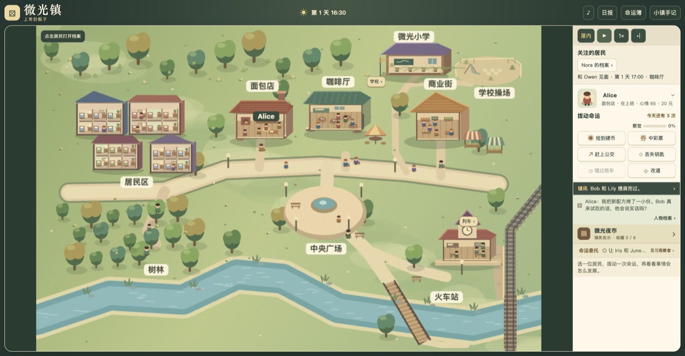
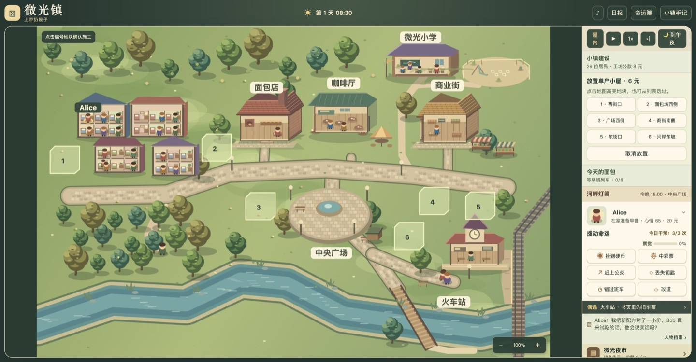
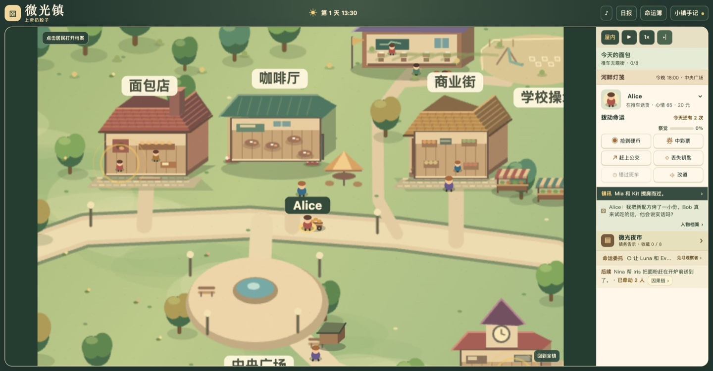
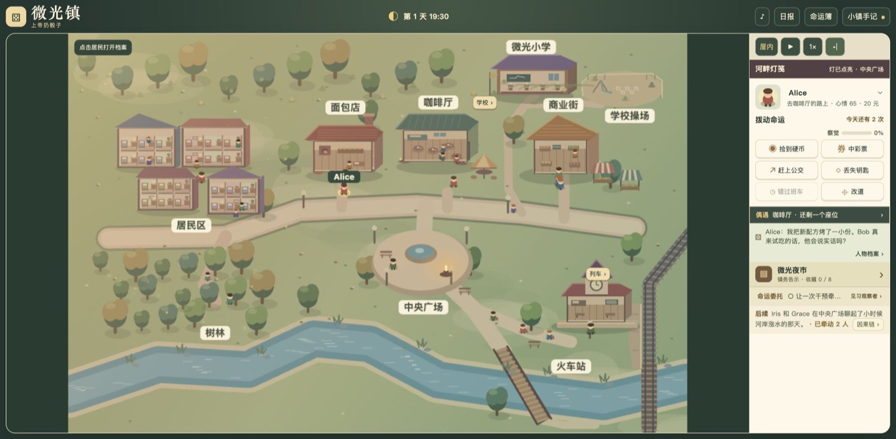
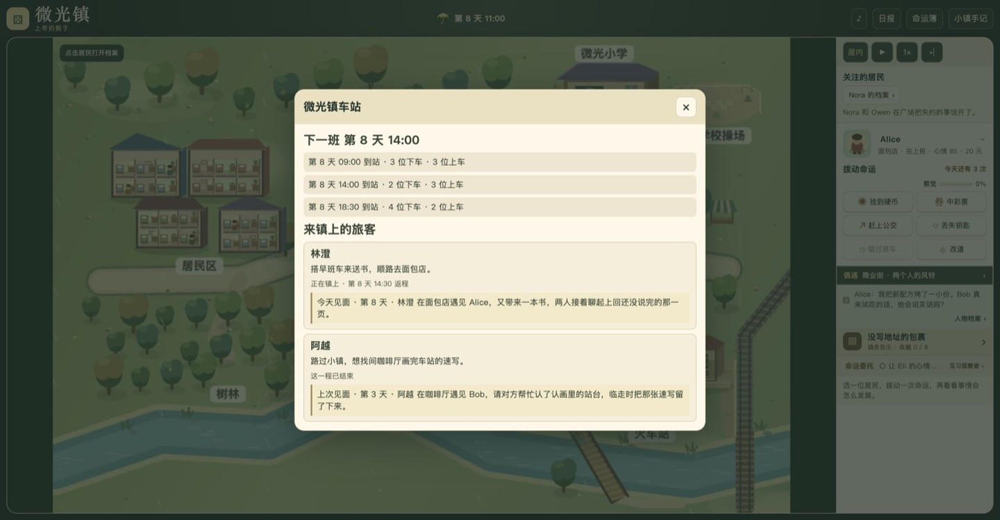
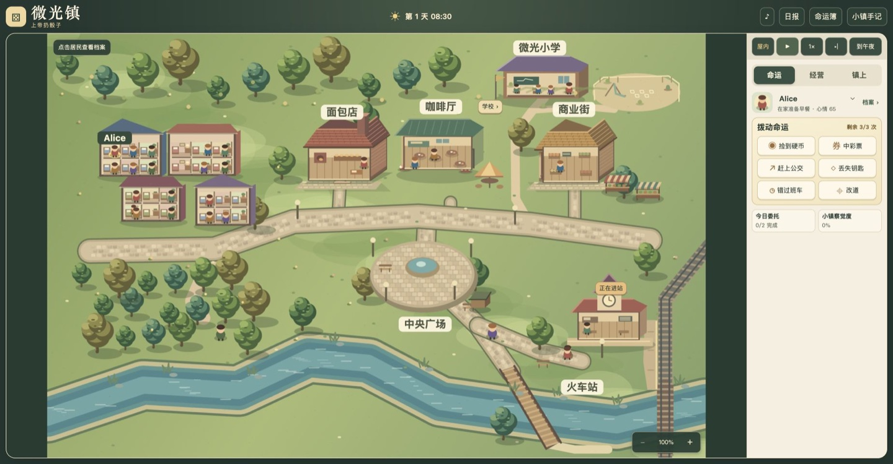
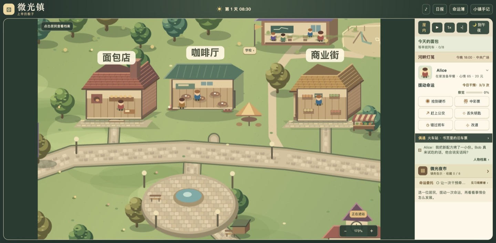

# 上帝扔骰子 · 微光镇

**[在线试玩《上帝扔骰子》](https://aubreykuang.github.io/SmallTown/)**


微光镇住着 29 位居民，每人都有自己的职业、日程、习惯和心情。你是路过的神，每天只有几次机会拨动命运——让某人中彩票、丢钥匙、错过班车——然后看着后果顺着真实的相遇传开。同一个拨动，在不同的日子会滚出不同的故事。

> 游戏界面为中文。

## 怎么玩

- **每天 3 次干预，面板显示「今日干预：N/M 次」。** 完成命运簿里的委托，第二天会多得干预次数（最多 5 次）。点地图上的居民，再选一种干预：捡到硬币、中彩票、赶上公交、丢失钥匙、错过班车，或「改道」指定一个目的地。
- **时间以半小时为一步。** 自动推进每 7.2 秒走半小时；可以暂停（⏸/▶）、切 3×、单步「▸|」推进半小时，或点「🌙 到午夜」直接推进到今天午夜结算日报。新开局从第 1 天早上 08:30 开始。
- **后果只在居民真正碰面时发生。** 干预本身不会凭空生效：中奖的人要遇到别人才会请客或被借钱，丢钥匙的人要遇上热心肠才有人帮忙找。
- **为心愿掷骰花 1 次干预。** 1–2 点会犹豫，3–4 点会自己去等，5–6 点会给两人都留出机会；但两人是否赴约、会不会开口，还要看日程和彼此的信任。
- **底部追踪栏**显示这次干预已经牵动了几个人；点「因果链」可以看到整棵事件树：好事绿色，坏事红色。

## 蝴蝶效应

一次干预不会只有一个结果：

- **中彩票**：热心的人请在场的人喝咖啡；务实的人买一束花送给最信任的人，对方的恋人可能吃醋；借钱被拒的人会到处说中奖者小气。
- **丢钥匙**：帮忙的人之后会收到面包、咖啡或谢卡；务实的人被善待三次以后，会变成热心肠（稀有）。
- **错过班车**：同事替你顶班；经常迟到的话，同事会去跟别人说。
- **改道**：偶遇的两个人可能约好明天再见——来了，信任加深；没来，被放鸽子的人会记住。
- **八卦与误会**：居民会把看到的事告诉同一地点的熟人，听到的人记下的是可信度较低的「传闻记忆」，有一定概率听岔，误会还会继续往下传。
- **友谊与告白**：两人互相信任到一定程度会成为朋友；再往上，一方会心动，两天后在广场告白。
- **集体事件**：雨天有人共撑一把伞；下雪天孩子们堆雪人；停电夜居民拿着手电去广场看星星；晴朗的夜里偶尔有流星雨（稀有）。好心情和坏心情都会在同一地点的人之间传染。

## 居民、约会与心愿

点地图上的居民，右侧「命运」栏下方会直接显示这个人的档案：看他正在做什么、心情如何、接下来要去哪、和谁是恋人、家人、朋友、同事或同学，以及最近记得什么。点关系里的人名可以直接切换到对方的档案。

- **约会**：Nora 和 Owen、June 和 Milo 会按自己的日程约会。赴约取决于两人是否到场和彼此的信任；失约会影响心情与记忆，之后还有机会见面把话说开。花一次干预掷骰，可以争取让收摊早点结束。
- **心愿**：Alice、Newton、Nina 和 Mia 各有两段会随经历推进的心愿，掷骰规则见上文。骰点、心愿进度和约会结果都会保存。


最多关注两位居民，操作栏会显示他们最近的约会、心愿见面、地图偶遇或镇务约定；点「到约定前半小时」可以快进并暂停。同一天的同一对居民最多记一条路上聊天。



## 小镇建设

点操作栏的「小镇建设」，选单户小屋或双户联排，再点地图上六块编号地块之一。也可以用地块列表选址。单户小屋花 6 元、施工两小时，可住一人。双户联排花 12 元、施工三小时，可住两人。住宅与站边货棚共用面包销售积累的工坊公款。

确认选址后，地图上会先出现脚手架，完工后变成可切换剖面的住宅。新住户在完工后的第一班早班车到站，之后会按职业和习惯活动，从自己选址的住宅出门和回家。可在建设面板快进到下一户抵达。施工、入住、居民与公款都会保存，竣工和入住也会登上日报。



## 今天的面包

每天 09:00，早班列车送来四袋面粉。居民从车站经货棚推车到面包坊，等面包师开炉，出炉后再送到商街。每天要在 18:00 收市前卖出八个面包，雨雪会拖慢运输，日报会记录当天卖出了多少。

- 把地图镜头移到商街并放大，可以近看面包坊的瓦片、炉火、推车和市场摊位。点面包坊、商街，或操作栏的「今天的面包」，可以查现在卡在哪一步、谁在负责。
- 早班卸货后，车站有空闲居民时，可以花一次干预请人帮忙。面包师会记得是谁帮忙送来的面粉。
- 卖出面包会增加工坊公款。攒到 12 元可修站边货棚，从次日早班开始走新路线，卸货到面包坊可节省一个游戏小时。库存、当日进度和货棚都随存档保存。



## 命运簿：委托、成就与 Newton

- **委托**：每天两件，比如让两个素不相识的人见上一面、让某人心情升到 85、让一次干预牵动 4 个人。每完成一件，第二天多 1 次干预，最多多 2 次；没完成的委托会在日报和命运簿里附上一句提示，告诉你下次可以试试什么。累计完成数提升称号：见习观察者 → 命运学徒 → 织线人 → 骰子之主。
- **成就**：14 张像素纪念卡，其中流星雨、改变一生、有情人 3 张是稀有卡，没解锁时连名字都不显示。解锁后可以保存为 PNG。
- **Newton 在怀疑**：Newton 只会记下自己亲眼看到、或从熟人那里听说的巧合。干预越频繁、越在人前，察觉度涨得越快，每天会回落一些。他会经历记笔记、在广场放硬币做实验、公开演讲几个阶段。笔记本内容和各阶段进度可以在「命运簿 › Newton 的笔记」里查看。
- **时光回溯**：每个游戏日第一次存档时会留一份快照，最多保留 4 天。回到某天以后，世界会照原样重演，除非你换一种拨法。

## 微光镇日报

每天午夜，系统会根据当天真实发生的事印一份日报：头条、蝴蝶效应、社交、新发现、小镇趣闻、关系变化、怪谈专栏（Newton 的笔记）和委托结算。满足条件时会出特别版，比如恋爱特刊、流星特刊、号外，或者「今天谁也没和谁搭话」的安静特刊。日报默认在每天结束时自动弹出，可以在报纸底部关闭，之后从顶栏「日报」翻看过去 14 天的报纸，每期都能保存成一张像素风纪念卡（PNG）。

## 地图偶遇、河畔灯笺与镇务

- **地图偶遇**：操作栏「镇上」里的偶遇消息可以打开正在发生的故事——旧车票、面包分赠、操场上的纸飞机、咖啡厅的空座或商街的风铃。同一场偶遇、同一对居民每天只出现一次。可以花一次干预给当场提示、安排次日再见，或者把决定交给居民。
- **河畔灯笺**：每隔三个游戏日，Iris、Grace 和 Alice 轮流在 18:00 留一盏灯。晴天和小雪在中央广场，细雨时挪进咖啡厅。可以旁观，也可以花一次干预捎一张灯笺：掷到 3–6 点的人会在有空时去，1–2 点时按原日程走。实际碰面后，两位居民各自留下记忆，玩家可以收进灯笺册，次日也能在日报里回看。



[查看 Iris 和 Grace 的灯笺收藏截图](docs/twilight-letter.jpg)

- **镇务告示**：微光夜市、没写地址的包裹、河岸的纪念按游戏日轮换，每个故事有两种办成的方式。选定方案和搭档后，镇务在次日 17:30 结算；搭档愿不愿意帮忙取决于职业、性格和对发起人的信任。
- **微光小学**：点地图右上方的「学校」查看老师 Marin 和四名学生。平日上课和课间，晴天孩子会去操场，下雨或下雪留在教室；周末不上课。学校告示有操场观察角和教室故事会两条活动，选搭档后次日 15:30 集合。镇务和学校共有八件可收藏的纪念物。


## 居民的安排与新邻居

- 「镇上」的「居民的安排」收录三段小故事。Alice 和 Bob 的试吃撞上晚班车，Marin 和 Newton 要在放学前交接旧书，Iris 和 Owen 要在收摊和挂灯之间腾出时间。点聊天气泡也能发现这些安排。
- 每次改安排花 1 次当天的干预。选项会改变碰面的时间、地点，或 Alice 的真实车票。错过时限，居民会试着在之后见面补救。结果会进入档案记忆和日报。已有存档可在「镇上」开启三段故事。
- 建房时，每块地会预告住户常经过的地方和可能遇见的人。靠近车站的新住户傍晚会去站台，面包店旁的住户傍晚会去面包店。双方有空且到了同一个地方才会打招呼，重复见面会积累信任。刚入住时，也可以从聊天里发现带新邻居认路的机会。

## 广场派对、风铃节与巡演

广场地图上的「活动」和右栏「镇上 → 广场活动」都能查看日历。每七个游戏日，街坊办一次茶点派对、一次风铃节，并迎接巡演手风琴手鹿野。鹿野在 14:00 搭车到站，有空的居民会去站台迎接。随后他步行到广场，16:30 开演，结束后返回车站搭晚班车。日历可以直接跳到到站或开场前。

广场会随活动出现旗串、风铃或小舞台。居民按空闲时间分批到场，活动后会恢复日程。出席情况进入日报，到场者会留下活动记忆。Pip 错过鹿野的演出后，有机会隔天在喷泉边跟一位到过场的居民学曲子。下一次鹿野来演出时，Pip 自己加的那一句可能成为新的结尾。可从广场上的小人动作、聊天气泡或事后日报发现这段故事。

## 列车与再来的旅客

火车每天 **09:00、14:00、18:30** 停靠，上下车前半小时可以看到列车进站。列车沿轨道进站、开门停靠、再离开，旅客依次上下车，下车的旅客会走到店铺附近，之后回来搭下一班。点车站旁的按钮可以看时刻和各班上下车人数。

在面包师、商贩或车站员工的人物档案里，可以安排两天的火车旅行。居民会先走到站台，搭晚班车离开，在出发日往后两天搭早班车回镇。离镇期间，档案和车站面板会显示目的地和返程时间，居民暂时退出镇内活动。返程时从列车门走下，心情有所改善，并记下带回的食谱、旧纽扣或线路图。出发与返程也会登上日报。

林澄每隔七个游戏日搭早班车来送书，顺路去面包店；阿越第 3 天路过微光镇，会去咖啡厅画车站速写。旅客到达店铺后，只有和一位空得出时间的居民碰上才会留下记忆；林澄回访时会优先找上次遇见的人，有机会接着聊那本书。




## 小镇界面

宽屏上，地图铺满左侧，时钟、掷骰和居民操作集中在右侧独立滚动栏；手机和窄窗口切成单列，地图占满屏宽，操作在地图下方。操作栏里的「屋内／外观」可切换住宅、面包店、咖啡厅、商街、学校和车站的剖面，居民会沿门口进出，在室内上班、喝咖啡、上课或候车时会显示在对应房间里。

地图会随游戏时间从晨雾过渡到暖色晚霞和冷色夜景。河面有流动的反光，雨雪分近远层飘动，晴夜有萤火虫，通电时路灯会照亮地面。居民在路上可能放慢脚步结伴同行，或停下来聊天，点击地图上的对话气泡，可以听他们提起刚搬来的邻居、从早班车下来的旅客、请客花的钱，或澄清听岔了的传闻。对白取材于存档里实际发生的事，居民会按关系决定跟谁聊；同一个人短时间内会换个话题。点聊天弹窗里的头像可以在右栏查看对应居民的档案。打开小镇手记会暂停时间和步行。

操作栏默认打开「命运」。点击地图上的居民会高亮选中，并在操作栏直接切到这个人，可以马上选择干预。人物档案在干预和委托下方随选中的居民更新。居民用各自的发型、衣装轮廓和配饰区分，地图、聊天头像和档案共用同一套造型。结果会出现在下方的「干预后续」，点「查看因果链」可追溯它怎么传开。今日委托和小镇察觉度保留简短状态，点击可打开命运簿详情。

「经营」显示人口、公款、建设和面包生产。「镇上」收纳正在发生的偶遇、河畔灯笺、镇务和关注的居民。角色心声、关系和记忆在「命运」栏下方查看，手机上位于地图和操作区下方。



[查看手机单列布局截图](docs/sidebar-mobile.jpg)


## 技术说明

静态网页，无需构建：用浏览器打开 `index.html`，或运行 `python3 -m http.server 8000` 后访问 `http://localhost:8000`。Canvas 2D 绘制地图和居民，Web Audio 合成背景音乐和操作音效，不依赖服务器、外部资源或 LLM。

存档存在 LocalStorage（当前为 v2，旧版 v1 会自动迁移；主档损坏时尝试读取上一有效快照）。支持 JSON 导出和导入；离线推进默认关闭，可开启并最多补算一个游戏日。

### 运行测试

```sh
node --test tests/*.test.cjs   # 需要 Node.js 22
```

测试覆盖游戏规则、人物互动、地图路线、列车与旅客、骰点分支、午夜日报与委托奖励、关注日报去重、灯笺遇雨改址、传闻传播范围、Newton 的感知条件、v1 存档迁移和快照回溯。

### 音乐与音效

点右上角「♪ 音乐」播放原创配乐《微光镇小径》。白天用木琴和轻柔和弦，夜里改成较低、较疏的音符。音乐在游戏画面打开时循环，切到其他浏览器标签页会暂停。「音效」单独控制干预、委托和成就提示音。

### 地图镜头

地图可在 100% 到 300% 之间自由缩放。电脑上用滚轮对准想看的地方缩放，按住地图拖动。触屏上可以双指捏合、单指拖动。右下角有加减按钮，点击中间的倍率可回到全镇。用键盘聚焦地图后，方向键移动，`+` 和 `-` 缩放，`0` 回到全镇。



### 代码结构

| 文件 | 职责 |
| --- | --- |
| `index.html` / `style.css` | 页面入口与界面样式，GitHub Pages 的试玩入口。 |
| `town-music.js` | 原创配乐、昼夜编曲和 Web Audio 播放控制。 |
| `ui.js` | 页面交互、时钟和动画循环、地图点选、面板更新、音效、存档接入。 |
| `world.js` | 世界状态、游戏时钟、随机种子、居民调度、干预结算和事件日志、存档校验与迁移。 |
| `npc-memory.js` | 客观事件与居民主观记忆的分开记录、筛选与合并。 |
| `save-manager.js` | LocalStorage 存档读写、版本检查、主档损坏回退、按游戏日的回溯快照。 |
| `town-ripples.js` | 干预的后续事件、传闻与关系变化、因果链查询。 |
| `town-wishes.js` | 居民的阶段性心愿、骰点分支、赴约与心愿进度。 |
| `town-relations.js` | 家庭与社交关系、伴侣约会、失约与和解。 |
| `town-moments.js` | 地图偶遇、当场选择、次日赴约及后续回访。 |
| `town-stories.js` | 镇务和学校项目的方案、搭档、集合、结算与纪念物。 |
| `town-school.js` | 师生名单、上课与课间安排、放学活动和学校日常互动。 |
| `town-paper.js` | 汇总当天的事件与关系变化，在午夜生成日报。 |
| `town-goals.js` | 每日委托、完成判定、额外干预次数和成就解锁。 |
| `town-skeptic.js` | Newton 对巧合的察觉、笔记、硬币实验和公开演讲。 |
| `town-twilight.js` | 河畔灯笺的轮值、赴约、不同话题与收藏。 |
| `town-build.js` / `town-build-art.js` | 住宅选址、施工、住户入住和地图绘制。 |
| `town-supply.js` | 面粉运输、烘焙、销售、干预和货棚改建。 |
| `town-trade-art.js` | 面包坊、商街、货棚和推车的 Canvas 绘制。 |
| `town-camera.js` | 全镇镜头、坐标转换、滚轮、拖动、双指捏合与键盘控制。 |
| `town-characters.js` | 居民、学生与旅客造型，以及服饰、配件、步态与睡姿绘制。 |
| `town-map.js` / `town-movement.js` | Canvas 地图合成与人物绘制、居民的连续移动、改道、结伴和路边聊天。 |
| `town-cards.js` | 日报和成就纪念卡的绘制与 PNG 导出。 |
| `town-watch.js` / `town-visitors.js` / `town-rail.js` | 关注名单与约定汇总、具名旅客、列车时刻与上下车。 |
| `town-routines.js` / `town-atmosphere.js` / `town-art.js` / `town-homes.js` / `town-interiors.js` | 居民起居与班次、昼夜光色与天气粒子、建筑与景观绘制、住宅与公共建筑剖面。 |
| `town-festivals.js` | 每周广场活动、巡演来访、接站与围观安排、出席记忆。 |
| `town-crossroads.js` | 限时选择、改签与赴约、错过后的补救、按住宅位置安排邻里往来。 |
| `town-conversations.js` | 按天气、性格、关系、公开事件和亲历的开销、旅行及传闻组织居民对话。 |
| `town-travel.js` | 居民旅行的订票、离镇、返程与返乡记忆。 |
| `tests/world.test.cjs` | Node.js 回归测试。 |
| `docs/` | README 使用的实机截图。 |

面包生产回归测试覆盖运输、雨天缺货、临时帮忙、货棚改建、存档恢复和收市日报。
